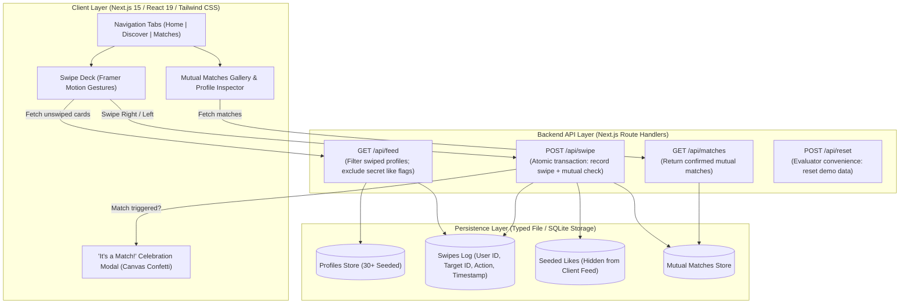

# Implementation Plan: Coy SDE Intern Assignment

## Executive Summary
This project implements the requirements outlined in `PRD.md` for the Coy SDE Intern Assignment. The assignment consists of two integral parts:
1. **Part A: Product Strategy & Feature Proposals** — Two high-impact, privacy-aligned core feature proposals tailored to Coy's unique double-blind crush mechanic.
2. **Part B: Engineering — Standalone "Discover" Tab Application** — A mobile-first, gesture-driven swipe discovery interface built with Next.js, React, Framer Motion, Tailwind CSS, and a persistent backend with zero-leak privacy enforcement.

---

## 1. Architectural Blueprint & Technical Stack

### Chosen Technology Stack (Latest Compatible Versions)

| Layer | Technology | Compatible Version | Role & Justification |
| :--- | :--- | :--- | :--- |
| **Framework** | **Next.js** | `^15.1.6` (App Router) | Unified React fullstack framework with modern Route Handlers, fast SSR/client hydration, zero CORS overhead. |
| **UI Library** | **React & React DOM** | `^19.0.0` | Default React engine bundled with Next.js 15, optimized for modern concurrent rendering. |
| **Language** | **TypeScript** | `^5.7.3` | Strict type safety for data models (`Profile`, `Swipe`, `Match`) and API request/response contracts. |
| **Styling** | **Tailwind CSS** | `^3.4.17` | Production-stable utility CSS with PostCSS (`^8.4.49`) & Autoprefixer (`^10.4.20`), enabling rapid mobile-first styling. |
| **Gestures & Animations** | **Framer Motion** | `^11.18.2` | Industry standard for fluid 60fps drag gestures, physics spring releases, rotation angles, and stamp opacity. |
| **Icons** | **Lucide React** | `^0.475.0` | Crisp, lightweight icons for bottom tab bar, swipe action buttons (Pass, Like, Info, Refresh). |
| **Celebratory FX** | **canvas-confetti** | `^1.9.3` (`@types ^1.9.0`) | Lightweight canvas confetti bursts for the "It's a Match!" celebration modal. |
| **Runtime & Package Mgr** | **Node.js & pnpm** | `Node v22.20.0` / `pnpm 11.9.0` | High-performance LTS runtime already verified on the host machine. |
| **Persistence Engine** | **Atomic File Store** | `fs/promises` (Native Node 22) | Atomic write-swap JSON persistence engine (`data/store.json`). Zero C++ build tool dependencies on Windows; 100% durable across reboots. |

---

## 2. Core Privacy & Matching Invariants

> [!IMPORTANT]
> **Coy's Core Promise: Zero Data Leakage**
> Under no circumstances does the client receive `hasLikedUser` or any boolean indicating that a profile has already liked the logged-in user.
> 
> - `GET /api/feed` strictly strips any internal like markers before responding.
> - The mutual match check happens exclusively within the `POST /api/swipe` backend handler.
> - A match is registered **only** when both users like each other.

---

## 3. Phased Implementation Roadmap

### Phase 1: Foundation & Data Modeling
- **Objective**: Establish the project workspace, configure Next.js with TypeScript and Tailwind CSS, and build the persistent storage engine.
- **Tasks**:
  1. Initialize Next.js project with App Router, TypeScript, and Tailwind CSS.
  2. Implement data schema:
     - `Profile`: `id`, `name`, `age`, `photos[]`, `bio`, `cityOrCollege`, `interests[]`, `occupation`.
     - `Swipe`: `userId`, `targetProfileId`, `action ('like' | 'pass')`, `timestamp`.
     - `Match`: `id`, `userId`, `profileId`, `matchedAt`.
  3. Seed **30+ realistic mock profiles** with high-resolution Unsplash photos, college/city metadata (e.g., Delhi, Bangalore, Mumbai universities), engaging bios, and interest tags.
  4. Seed **8-10 pre-existing incoming likes** secretly on the backend so matches naturally occur during demo swipes.
  5. Build a data access repository with atomic persistence (`data/store.json` or SQLite).

### Phase 2: Backend API Endpoints & Verification
- **Objective**: Implement clean, robust REST endpoints complying directly with PRD specifications.
- **Tasks**:
  1. `GET /api/feed`:
     - Reads all profiles.
     - Excludes any profile ID present in the user's swipe history.
     - Sanitizes payloads (strips internal match secrets).
  2. `POST /api/swipe`:
     - Validates payload: `{ profileId: string, action: 'like' | 'pass' }`.
     - Appends swipe record to persistence.
     - If `action === 'like'`, checks if target profile has an incoming like towards the user.
     - If mutual: creates a `Match` record and returns `{ success: true, isMatch: true, profile: matchedProfile }`.
     - If not mutual: returns `{ success: true, isMatch: false }`.
  3. `GET /api/matches`:
     - Returns list of mutual matches enriched with profile details and timestamp.
  4. `POST /api/reset` (Bonus Utility):
     - Resets user swipes and restores initial seeded state for easy testing.
  5. Verify endpoints with automated health-check tests.

### Phase 3: Mobile-First Layout & Tab Architecture
- **Objective**: Create an authentic mobile-first frame and the required navigation tabs.
- **Tasks**:
  1. Build a responsive viewport container:
     - Centered smartphone mockup frame on desktop (iPhone/Android aspect ratio with subtle bezel and shadow).
     - Fluid edge-to-edge layout on mobile devices.
  2. Bottom Tab Bar:
     - **Home Tab**: Minimal placeholder with Coy branding / subtle greeting (as explicitly specified: *"Keep the Home tab blank and build the functionality in Discover Tab"*).
     - **Discover Tab**: The active swipe deck experience with a notification badge.
     - **Matches Tab**: Dedicated screen listing mutual matches with active badge counts.
  3. Top Navigation Header: Coy wordmark, profile indicator, and a quick "Reset Demo" button.

### Phase 4: Swipe Experience & Physics-Based Gestures
- **Objective**: Replicate top-tier dating app swipe mechanics (Tinder/Bumble caliber) with Framer Motion.
- **Tasks**:
  1. Single-card focus with layered background card preview (giving depth and stack perception).
  2. Interactive Drag Gestures:
     - Responsive drag tracking (`drag="x"`, `dragConstraints={{ left: 0, right: 0 }}`).
     - Dynamic rotation based on drag offset (e.g., `rotate = x * 0.1deg`).
     - Overlaid stamps: Green **LIKE** stamp fades in as card drags right; Red **NOPE** stamp fades in as card drags left.
  3. Threshold & Velocity Release:
     - Swiping beyond $\pm 100\text{px}$ or flicking with velocity triggers smooth flyout animation.
     - Optimistic UI: next card is instantly ready; background API call records swipe.
  4. Desktop Action Controls:
     - Action buttons: ❌ Pass (Left), ℹ️ Info Modal, 💚 Like (Right).
     - Keyboard shortcuts: `ArrowLeft` (Pass), `ArrowRight` (Like), `Space` (Info).
  5. Detailed Profile Inspector:
     - Tap card or Info button to view expanded bio, multiple photos, college badge, and interest tags.
  6. Empty State:
     - Engaging "You've caught up!" screen with animation and a "Reset Feed" button.

### Phase 5: Mutual Matching & Celebratory Experience
- **Objective**: Deliver instant gratification when a mutual like occurs without breaking privacy invariants.
- **Tasks**:
  1. Trigger instant modal when `POST /api/swipe` responds with `isMatch: true`.
  2. Modal UX:
     - "It's a Match!" animated headline.
     - Dual interlocking profile avatars (current user + matched profile).
     - Confetti burst effect (`canvas-confetti`).
     - Action buttons: "Keep Swiping" (dismiss modal and continue) or "Say Hello" (switches to Matches tab).
  3. Matches Screen:
     - List/Grid of all mutual matches.
     - Displays match timestamp, photo, name, college, and a placeholder "Send Message" prompt.
     - Empty state for matches when no mutual likes have occurred yet.

### Phase 6: Assignment Deliverables & Production Polish
- **Objective**: Complete documentation, final UI polish, and package the project for evaluation.
- **Tasks**:
  1. Author the required Part A feature suggestions and rationale in the project documentation.
  2. Polish styling, transitions, loading skeletons, and error handling.
  3. Document setup instructions, architectural decisions, and testing workflows in `README.md`.

---

## 4. Verification & Testing Strategy

1. **API Persistence Verification**:
   - Make swipes $\to$ refresh page $\to$ verify swiped profiles do not reappear.
   - Verify matched profiles are persisted in `GET /api/matches`.
2. **Gesture & UI Testing**:
   - Test touch swipe on mobile screen resolutions.
   - Test mouse drag, action buttons, and keyboard arrow navigation on desktop.
3. **Privacy Integrity Check**:
   - Inspect network payload in devtools: verify `GET /api/feed` exposes zero hints regarding who liked the user.
4. **Match Trigger Test**:
   - Swipe right on seeded profiles known to like the user $\to$ confirm celebratory modal triggers every time.
   - Swipe right on profiles that have not liked the user $\to$ confirm quiet like without match.
